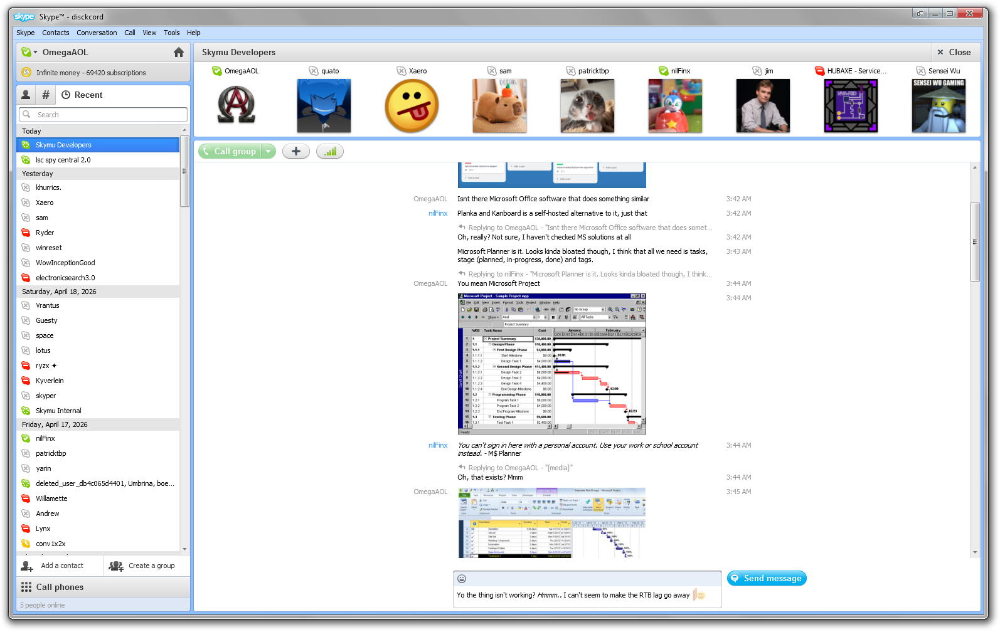
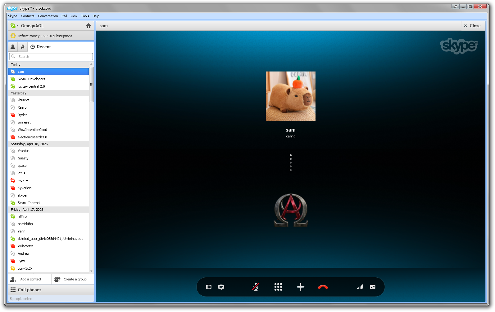

 

# What is Skymu?
Skymu is a modern multi-platform IM client that looks like classic versions of Skype, with skins perfectly resembling Skype 4, 5, 6, and 7. Officially supported messaging services include Discord, Matrix, Tox, MSNP11, and some other platforms.

 

 

# Build Guide
For this guide, you will need Git for Windows, Visual Studio 2019 (or newer) and NSIS 3 (or newer). Support will not be provided if older build tools are used. 

* [Download Git for Windows](https://git-scm.com/install/windows) and install. For the default editor, we recommend you select Notepad (or Notepad++, etc. if you have it) instead of Vim, unless of course you feel like dedicating a few days to learning how to use Vim. Stick with the default options for the other things the installer asks you.
* [Download Visual Studio 2026](https://aka.ms/vs/18/Stable/vs_community.exe) (recommended) or [download Visual Studio 2019](https://aka.ms/vs/16/release/vs_community.exe). Select the ".NET desktop development" workload in the installer. If you plan to work with forms/UserControls/.axaml files, it's highly recommended to get the Avalonia VS extension.
* [Download NSIS](https://sourceforge.net/projects/nsis/files/latest/download). Staying on the latest version is recommended.

A plugin development guide is available on the website: https://www.skymu.app/wiki/yggdrasil

## Application

Open Command Prompt, navigate to the folder you want Skymu in, and run `git clone https://github.com/TheSkymuTeam/Skymu.git` to download the repository.

Open the `Skymu.sln` solution file with Visual Studio.

 
Select the "Debug" configuration in the action bar.

If you want to change the internal name (recommended to avoid conflicts with your existing Skymu installation!) or version, go to `Skymu/Skymu/App.xaml.cs` in the Solution Explorer pane, click to open the file, and then edit these values. Note that changing this will make the updater stop working.

Press `Ctrl + Shift + B` to build the solution for the first time, or click "Build Solution" in the menu bar under "Build".

Click the play button on the action bar to run your copy of Skymu. 

If you are encountering conflicts after making your changes, click "Rebuild Solution" to clean cache and build from scratch.

## Installer
Select the "Release" configuration in the action bar and build Skymu in Visual Studio.

Navigate to the `NSIS` folder, right-click on `SkymuSetup-AnyCPU-Release.nsi`, and then click "Compile NSIS Script". The other scripts are intended for the Github Actions CI pipeline.

The NSIS compiler will run. After it's finished, the output log will turn green and `Skymu.Installer.AnyCPU.Release.exe` will show up in the folder; click "Test Installer" to run it.

# Open-source dependencies

| Software | Author | License | Used in | Source code |
|---|---|---|---|---|
| Avalonia | AvaloniaUI | [MIT](https://choosealicense.com/licenses/mit/) | Skymu | [Repo](https://github.com/AvaloniaUI/Avalonia) |
| Avalonia.Controls.WebView | Devolutions | [MIT](https://choosealicense.com/licenses/mit/) | Skymu | [Repo](https://github.com/Devolutions/Avalonia.Controls.WebView) |
| Avalonia.Desktop | AvaloniaUI | [MIT](https://choosealicense.com/licenses/mit/) | Skymu | [Repo](https://github.com/AvaloniaUI/Avalonia) |
| Avalonia.Diagnostics | AvaloniaUI | [MIT](https://choosealicense.com/licenses/mit/) | Skymu | [Repo](https://github.com/AvaloniaUI/Avalonia) |
| Avalonia.Markup.Xaml.Loader | AvaloniaUI | [MIT](https://choosealicense.com/licenses/mit/) | Skymu | [Repo](https://github.com/AvaloniaUI/Avalonia) |
| Avalonia.Themes.Fluent | AvaloniaUI | [MIT](https://choosealicense.com/licenses/mit/) | Skymu | [Repo](https://github.com/AvaloniaUI/Avalonia) |
| Avalonia.Themes.Simple | AvaloniaUI | [MIT](https://choosealicense.com/licenses/mit/) | Skymu | [Repo](https://github.com/AvaloniaUI/Avalonia) |
| BouncyCastle.Cryptography | Legion of the Bouncy Castle | [MIT](https://choosealicense.com/licenses/mit/) | Bifrost, Discord | [Repo](https://github.com/bcgit/bc-csharp) |
| c-toxcore | The TokTok team | [GPL v3](https://choosealicense.com/licenses/gpl-3.0/) | Tox | [Repo](https://github.com/toktok/c-toxcore) |
| Classic.Avalonia.Theme | BAndysc | [LGPL-2.1-only AND MIT](https://choosealicense.com/licenses/lgpl-2.1/) | Skymu | [Repo](https://github.com/BAndysc/Classic.Avalonia) |
| CommunityToolkit.Mvvm | Microsoft | [MIT](https://choosealicense.com/licenses/mit/) | Skymu | [Repo](https://github.com/CommunityToolkit/dotnet) |
| Concentus | Logan Stromberg | [BSD-3-Clause](https://choosealicense.com/licenses/bsd-3-clause/) | Discord | [Repo](https://github.com/lostromb/concentus) |
| Devlooped.CredentialManager | Devlooped | [MIT](https://choosealicense.com/licenses/mit/) | Skymu | [Repo](https://github.com/devlooped/CredentialManager) |
| Google.Protobuf | Google | [BSD-3-Clause](https://choosealicense.com/licenses/bsd-3-clause/) | Discord | [Repo](https://github.com/protocolbuffers/protobuf) |
| libopus | Xiph.Org and others (including Skype Limited) | [BSD 3-Clause](https://choosealicense.com/licenses/bsd-3-clause/) | Tox | [Repo](https://github.com/xiph/opus) |
| libsodium | jedisct1 | [ISC](https://choosealicense.com/licenses/isc/) | Tox | [Repo](https://github.com/jedisct1/libsodium) |
| Markdig | Alexandre Mutel | [BSD-2-Clause](https://choosealicense.com/licenses/bsd-2-clause/) | Skymu | [Repo](https://github.com/xoofx/markdig) |
| Microsoft.CSharp | Microsoft | [MIT](https://choosealicense.com/licenses/mit/) | Discord, Yggdrasil | [Repo](https://github.com/dotnet/runtime) |
| Microsoft.Data.Sqlite | Microsoft | [MIT](https://choosealicense.com/licenses/mit/) | Skymu, Skype DB Browser | [Repo](https://github.com/dotnet/efcore) |
| NAudio.Core | Mark Heath | [MIT](https://choosealicense.com/licenses/mit/) | Discord, Skymu, Stub, Tox | [Repo](https://github.com/naudio/NAudio) |
| NAudio.WinMM | Mark Heath | [MIT](https://choosealicense.com/licenses/mit/) | Discord, Stub, Tox | [Repo](https://github.com/naudio/NAudio) |
| NLayer.NAudioSupport | Mark Heath | [MIT](https://choosealicense.com/licenses/mit/) | Stub | [Repo](https://github.com/naudio/NLayer) |
| pthreadVC3 | rosspjohnson | [Apache-2.0](https://choosealicense.com/licenses/apache-2.0/) | Tox | [Sourceforge](https://sourceforge.net/projects/pthreads4w/) |
| QRCoder | Shane32 | [MIT](https://choosealicense.com/licenses/mit/) | Skymu | [Repo](https://github.com/Shane32/QRCoder) |
| SharpZipLib | ICSharpCode | [MIT](https://choosealicense.com/licenses/mit/) | Discord | [Repo](https://github.com/icsharpcode/SharpZipLib) |
| Silk.NET.OpenAL | Silk.NET team | [MIT](https://choosealicense.com/licenses/mit/) | Skymu | [Repo](https://github.com/dotnet/Silk.NET) |
| System.Security.Cryptography.ProtectedData | Microsoft | [MIT](https://choosealicense.com/licenses/mit/) | Skymu | [Repo](https://github.com/dotnet/dotnet) |
| System.Text.Json | Microsoft | [MIT](https://choosealicense.com/licenses/mit/) | Chat Completions, Discord, Matrix, Skymu | [Repo](https://github.com/dotnet/dotnet) |
| System.Threading.Channels | Microsoft | [MIT](https://choosealicense.com/licenses/mit/) | Chat Completions, Discord, Stub, Tox | [Repo](https://github.com/dotnet/runtime) |
